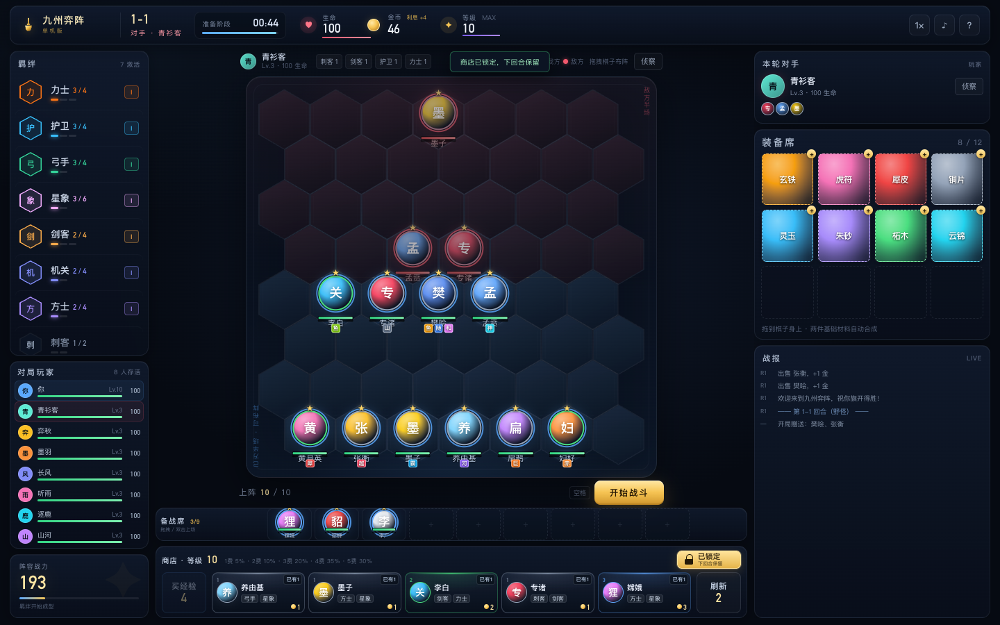
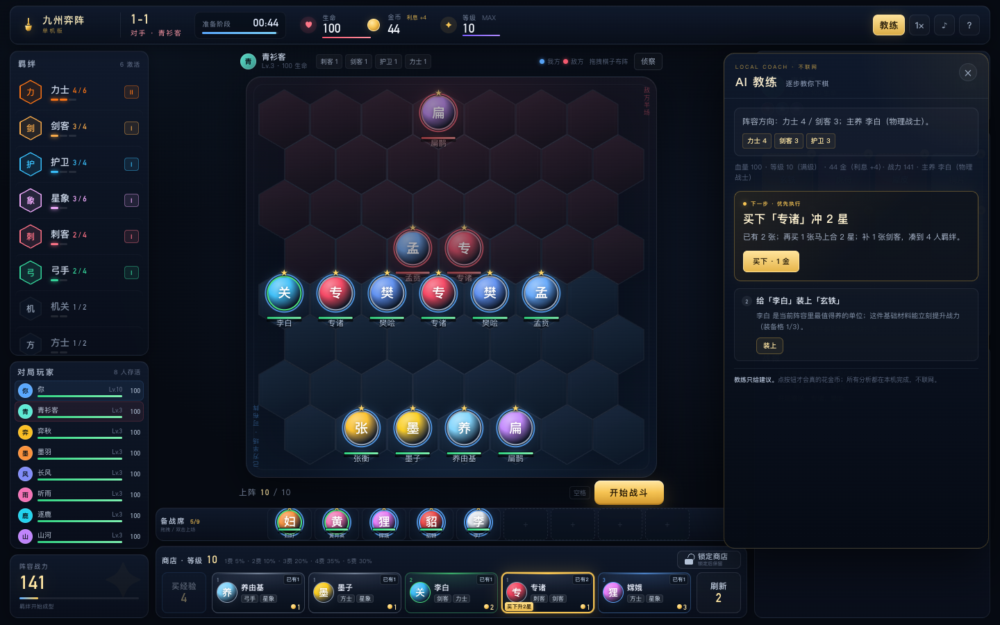

# 九州弈阵 · 单机版

一个**完全离线**的单机自走棋小游戏，采用六边形棋盘与自动战斗玩法。
打开网页就能玩，无需安装、无需联网，也没有匹配和排队。



*预览图使用测试阵容；实际对局从 1-1 开始，逐步运营成型。*

> **原创单机作品。** 28 位人物取自中国历史与传说，人物属于公有领域；技能名称、技能文案、羁绊、装备与数值均为本项目的原创设计，不含任何官方图片或音频素材。



*点右上角「教练」，它会按当前局面给出下一步和原因；所有分析都在本机完成。*

---

## 立即开玩

**方式一：双击 `index.html`**

**方式二（macOS）：双击 `启动游戏.command`**
会优先用 Chrome 打开；没有 Chrome 时使用默认浏览器。

建议使用 **Chrome / Edge / 最新版 Safari**，窗口大小 **1280×720 以上**。
游戏会自适应 720p、900p、1080p 等常见桌面分辨率。

> 如果浏览器限制本地文件，也可以在本目录运行：
> `python3 -m http.server 8080`，然后访问 <http://localhost:8080>。

---

## 这一版有什么

- **28 位华夏英雄**，1~5 费，3 个相同棋子合成 2 星，3 个 2 星合成 3 星；开局从 7 名 1 费英雄中随机赠送 2 名（21 种组合，连续两局不会重复）。
  - 1 费：樊哙、养由基、墨子、专诸、孟贲、扁鹊、张衡
  - 2 费：李白、妇好、黄月英、岳云、穆桂英、要离
  - 3 费：嫦娥、貂蝉、花木兰、李广、廉颇、典韦
  - 4 费：聂政、诸葛亮、项羽、后羿、孙膑
  - 5 费：关羽、姜子牙、韩信、蔡文姬
- **10 大羁绊**：剑客、方士、刺客、力士、护卫、弓手、玄术、星象、龙脉、机关。
- **棋盘优先布局**：备战席在商店正上方；买经验在商店左侧、刷新在右侧；装备席、对手和战报在右栏，羁绊与玩家列表在左栏；中间棋盘尽量放大。
- **8 种基础材料 + 36 件传统器物**：两件基础材料拖到同一个英雄身上会自动合成，完整覆盖 8 种基础材料的 36 种组合。
  - 基础材料：玄铁、柘木、朱砂、灵玉、犀皮、铜片、云锦、虎符。
  - 核心器物包括鱼肠剑、巨阙剑、随侯珠、河图洛书、犀皮宝甲、山文甲、神农鼎、八卦镜、越女剑、尚方宝剑、昆仑镜、鱼鳞甲、霸王枪、和氏璧、赤焰战袍等。
  - 其余组合包含干将、莫邪、湛卢、龙渊、后羿弓、明光铠、孙子兵法、八阵图、赤兔、的卢等传统器物与名马。
  - 其中 15 件核心成品带独特效果，其余组合以属性加成为主。
- **7 个 AI 对手 + 你 = 8 人淘汰赛**：每个 AI 有固定羁绊偏好，会随回合升级、升星、带装备，也会互相厮杀。
- **完整运营系统**：商店刷新、买经验、最高 10 级（10 人口）、利息、连胜/连败、三星追梦；战斗回合也能购买、刷新、锁定和买经验。
- **商店提示**：卡牌右上角显示已有数量；买下能升星时，卡牌会变金色并提示“买下升 2 星 / 3 星”。
- **拖拽布阵 + 自动战斗**：六边形棋盘、刺客跳后排、技能/护盾/控制/灼烧、伤害数字与战斗音效；我方蓝色描边/底光，敌方红色，战斗时头像旁有“我/敌”标记。
- **侦察对手**：布阵阶段可以查看对手阵容、星级和装备；点击敌方英雄会弹出详情，显示“物理射手 / 魔法坦克 / 治疗辅助”等定位。
- **三种难度**：轻松 / 标准 / 挑战，AI 强度、等级和伤害不同。
- **PvE 野怪回合**：荒原狼群、石甲兽、撼地巨猿、赤炎蛟、九幽烛龙。
- **AI 教练**：点游戏右上角的「教练」，它会根据当前血量、金币、等级、商店、备战席和羁绊，逐步推荐买哪张、是否升级/刷新、先上谁、装备给谁、前后排怎么站，并说明原因。教练完全在本机运行，不联网、不需要 DeepSeek API。
- **键盘操作**：空闲时可用快捷键完成刷新、买经验、购买、出售等操作。

---

## 快速上手

1. 开局会赠送 2 个 1 费棋子，商店里有 5 张卡。
2. 点击商店卡购买棋子，棋子会进入**备战席**。
3. 把备战席棋子**拖到己方半场**（下半区）上阵；也可以双击棋子自动上场。
4. 左上角显示当前羁绊。尽量凑齐 2/4/6 等数量阈值；不确定时点右上角「教练」，按它给出的下一步操作。
5. 点击 **开始战斗**（或按空格）。战斗自动进行，站位和阵容决定胜负。
6. 每回合结束会结算金币与经验；在商店里买经验可以提升等级、增加上阵人数。
7. 生命归零即被淘汰。活到最后即可吃鸡。

### 经济小抄

| 项目 | 数值 |
| --- | --- |
| 每回合基础收入 | 5 金 |
| 存款利息 | 每 10 金 +1，最多 +5 |
| 连胜/连败奖励 | 2 场起 +1，4 场 +2，5 场 +3 |
| 刷新商店 | 2 金 |
| 买经验 | 4 金 = 4 经验 |
| 升级 | 等级越高，上阵位越多，高费卡概率越大；最高 10 级、10 人口 |
| 出售棋子 | 返还全部投资（1 星原价、2 星 3 倍、3 星 9 倍） |
| 出售装备 | 基础材料 +1 金，成品器物 +2 金 |
| 卸下装备 | 选中己方棋子后点“卸装备”，装备退回装备席（需空位，准备阶段） |

更多规则可以在游戏内点击右上角 **?** 查看。

---

## 操作

| 操作 | 说明 |
| --- | --- |
| 拖拽 | 棋子上下阵、交换位置、把装备拖到棋子身上 |
| 单击棋子 | 选中；再点击棋盘格子可移动；点击敌人可查看其详情 |
| 详情弹窗 | 显示物理/魔法定位（物理射手、魔法坦克等）、羁绊、属性、技能与装备；敌方棋子也能点 |
| 双击备战席棋子 | 自动上场 |
| 拖到商店 | 出售棋子 / 装备 |
| 空格 | 开始战斗 / 继续结算 |
| C | 打开 / 关闭 AI 教练 |
| 商店锁定 | 点击商店标题行右侧的锁定按钮，锁定时变金色，下回合保留卡牌 |
| D | 刷新商店（战斗中也可） |
| F | 买经验（战斗中也可） |
| 1–5 | 购买对应位置的商店棋子 |
| E | 出售当前选中的棋子 |
| Esc | 关闭弹窗 / 取消选择 |

> 每名棋子最多 3 个装备格；两件基础材料会自动合成成品。装备在下一场战斗生效。选中自己的棋子后，可在下方点“卸装备”把装备退回装备席。

---

## 文件结构

```
九州弈阵/
├── index.html          # 页面入口
├── css/style.css       # 全部界面样式与动画
├── js/data.js          # 28 位英雄 / 羁绊 / 装备 / 野怪 / AI 配置
├── js/engine.js        # 六边形自动战斗引擎（无 DOM，可独立测试）
├── js/game.js          # 商店、经济、等级、AI 对手、淘汰结算
├── js/coach.js         # 本地 AI 教练：买棋/升级/刷新/装备/站位建议
├── js/ui.js            # 渲染、拖拽、提示、战斗特效、音效
├── js/main.js          # 启动
├── favicon.svg         # 站点图标
├── preview.png         # 界面预览
├── preview-battle.png  # 战斗预览
├── preview-enemy.png   # 敌方英雄详情
├── preview-detail.png  # 英雄详情与卸装备入口
├── preview-coach.png   # AI 教练面板
├── 启动游戏.command     # macOS 启动器
├── LICENSE             # MIT
└── README.md
```

---

## 设计说明与局限

这是一个**原创简化版**自走棋，不是任何商业自走棋产品的完整复刻。当前版本刻意没有做：

- 额外的英雄强化 / 全局强化机制；
- 转职类特殊装备；
- 共享牌池、选秀；
- 真实玩家匹配与排位；
- 账号、云存档。

AI 之间的胜负使用战力估算，玩家与 AI 的战斗则是完整的六边形棋盘模拟。
所有数值都在本机计算；刷新页面会重新开始一局。

---

## 技术

纯 **HTML + CSS + Vanilla JavaScript**，零依赖、零外部请求。
战斗引擎与界面分离，`js/engine.js` 可以在 Node 中单独跑测试。
界面使用系统字体与 CSS 绘制，没有图片素材，因此可以完全离线运行。
AI 教练使用本地规则与局面评估，不调用外部 API，也不需要 API Key。

---

## 许可

代码以 **MIT License** 发布；人物名称取自公有领域的历史与传说，技能文案、羁绊、装备与数值为本项目原创设计。
